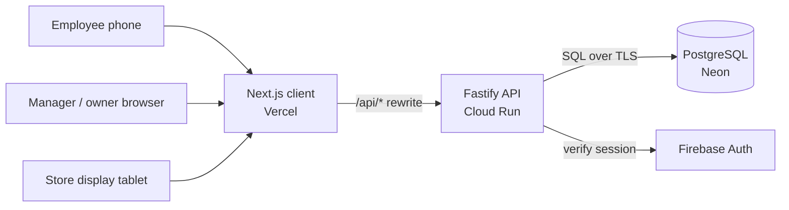

# Architecture

QRShift is moving from a single Next.js app (client + route handlers + Firestore) to a client-server split: a Next.js client, a standalone Fastify API, and PostgreSQL. This document describes both the current state and the target, and is updated as each part lands.

## Status

| Component | Current | Target |
| --- | --- | --- |
| Client | Next.js on Vercel (`web/`) | Same, with no server code |
| API | Next.js route handlers (`web/src/app/api`) | Fastify on Cloud Run (`api/`) |
| Database | Cloud Firestore | PostgreSQL on Neon |
| Auth | Store PIN + signed cookie | Firebase Authentication + roles |

## Target system

The browser only talks to the Vercel origin. Vercel forwards `/api/*` to Cloud Run, so session cookies stay first-party. Only the API can reach the database.

## Repository layout

| Path | Responsibility |
| --- | --- |
| `web/` | UI routes: `/` landing, `/scan/[qr_token]`, `/dashboard/[qr_token]`, `/reports/[qr_token]`, `/admin` |
| `api/` | Fastify REST API; `buildApp()` in `src/app.ts` is the entry used by both the server and tests |
