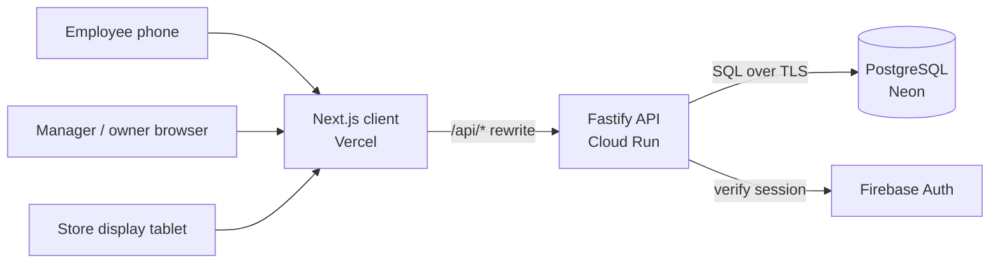
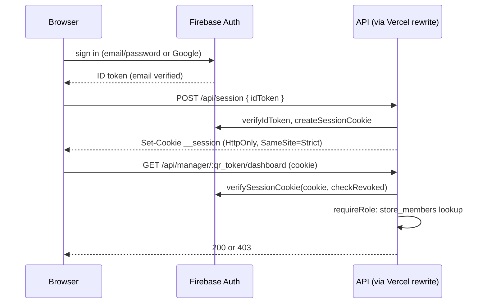
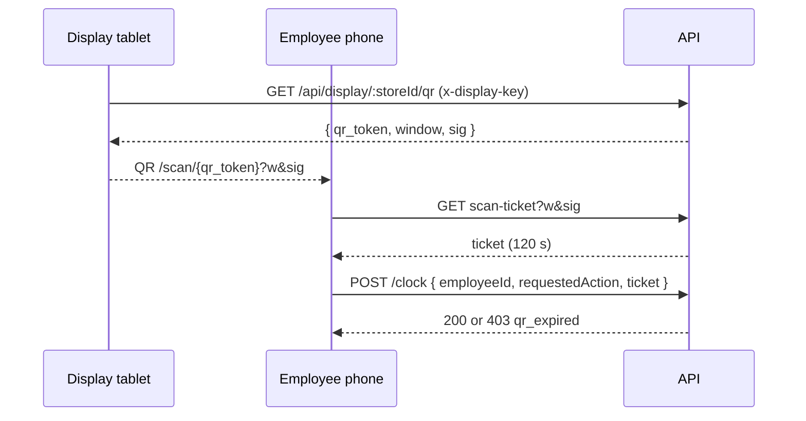
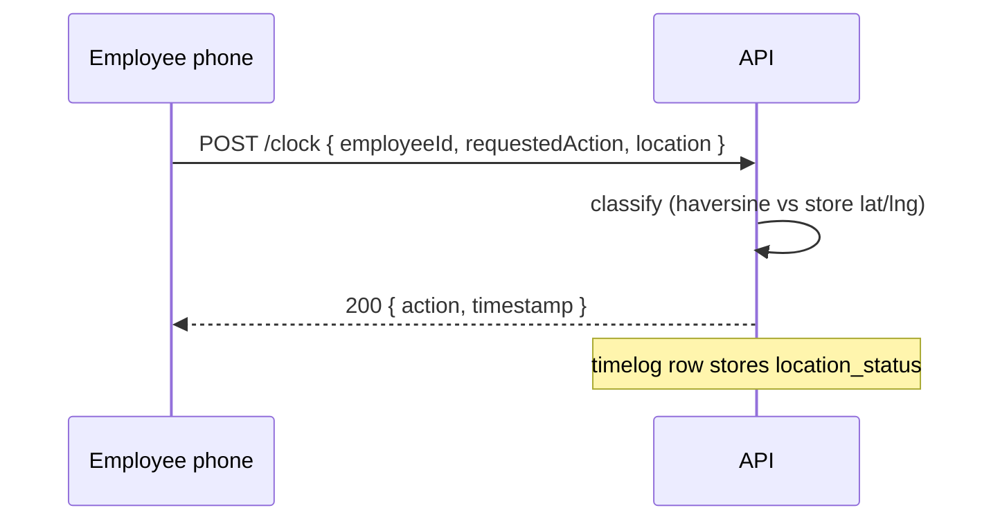

# Architecture

QRShift is a client-server split: a Next.js client, a standalone Fastify API, and PostgreSQL. The client contains no server code.

## Components

| Component | Where |
| --- | --- |
| Client | Next.js on Vercel (`web/`), no server code |
| API | Fastify on Cloud Run (`api/`), serving all `/api/*` routes |
| Database | PostgreSQL on Neon |
| Auth | Firebase Authentication session cookies + store roles |

## System overview



The browser only talks to the Vercel origin. Vercel forwards `/api/*` to Cloud Run, so session cookies stay first-party. Only the API can reach the database.



## Security model

**Identity.** Users sign in with Firebase Authentication (email/password or Google). Google sign-in uses a popup only; there is no redirect fallback. The browser posts the Firebase ID token to `POST /api/session`; the API verifies it, requires a verified email, and exchanges it for a Firebase **session cookie** (`__session`, 5 days, `HttpOnly; Secure; SameSite=Strict; Path=/`). Every protected route verifies the cookie with `verifySessionCookie(cookie, true)` (revocation checked), so signing out or disabling an account takes effect immediately. Signing out (`DELETE /api/session`) revokes the user's refresh tokens, which ends their sessions on every device, and then clears the cookie even if revocation fails.

**Authorization.** `store_members(store_id, email, role)` is the only source of access. `requireRole('manager' | 'owner')` is a Fastify `preHandler` that resolves the store from `:storeId` or `:qr_token`, looks up the caller's role and answers **403** unless the role is sufficient (owner satisfies manager). Unknown stores are also 403. Handlers contain no role checks. `requireSession` only requires a signed-in user (used by store creation and `/api/me`). The QR controls (`api/src/routes/qr.ts`: mode, location, reissue, display-key reset) use `requireRole('owner')` with the store taken from `:storeId`, so managers cannot reach them; `qr_secret` is never returned and `display_key` only to owners.

**CSRF (three independent layers).**
1. `SameSite=Strict` session cookie; the site and API share one origin through the Vercel rewrite.
2. State-changing routes accept only `application/json`. Form-encoded, multipart and `text/plain` bodies (the CORS "simple" types that cross-site forms can send without a preflight) answer 415 `unsupported_media_type`, and the API sends no CORS headers, so other sites cannot read responses or send credentialed cross-origin JSON.
3. A global `onRequest` hook answers 403 `forbidden_origin` to any non-GET/HEAD request whose `Origin` is not `APP_ORIGIN`, including `POST /api/session`, the public `POST …/clock`, and requests with no `Origin`. Browsers always send `Origin` on `fetch` POSTs, so employees' phones pass. GET routes never mutate state.

Direct calls to the `*.run.app` URL carry no session cookie, so they are unauthenticated. Limit: a single `APP_ORIGIN` means Vercel preview deployments can read through the API but cannot write.

**Public routes.** Scanning needs no account: `GET /api/stores/:qr_token`, `GET …/employees`, `GET …/scan-ticket`, `POST …/clock`. In display mode the clock call needs a ticket (see [QR signing](#qr-signing)). `GET /api/display/:storeId/qr` is also unauthenticated but needs the store's `display_key` in the `x-display-key` header; it answers 401 `invalid_display_key` for an unknown store, a printed store, or a missing or wrong key, so it reveals nothing about which case applies. Secrets are compared with `timingSafeEqual`.

## Environment variables

| Name | Where | Purpose |
| --- | --- | --- |
| `DATABASE_URL` | API | Neon connection string |
| `FIREBASE_PROJECT_ID` | API | Firebase project for token and session-cookie verification (`qr-shift-f2063`); credentials come from the runtime service account (Application Default Credentials) |
| `APP_ORIGIN` | API | The site's origin (`https://…`, no path); state-changing requests from any other origin are refused. The API refuses to start without it |
| `API_ORIGIN` | Web (Vercel) | Cloud Run URL the `/api/*` rewrite forwards to; required in production and previews, defaults to `http://127.0.0.1:8080` locally |
| `NEXT_PUBLIC_FIREBASE_API_KEY`, `_AUTH_DOMAIN`, `_PROJECT_ID`, `_APP_ID` | Web | Firebase web SDK config (public values) |
| `NEXT_PUBLIC_DEMO_BOOKING_URL`, `NEXT_PUBLIC_CONTACT_EMAIL` | Web | Landing page links: demo booking (Calendly) and `mailto:` contact (`web/src/lib/site-config.ts`) |

## Repository layout

| Path | Responsibility |
| --- | --- |
| `web/` | UI only, no server code. Routes: `/` landing, `/display/[storeId]`, `/scan/[qr_token]`, `/dashboard/[qr_token]`, `/reports/[qr_token]`, `/admin` (owner console also manages who can sign in per store via `StoreMembersPanel`, and the QR mode, display link, store location and QR reissue via `QrSettingsPanel`, which calls the owner QR endpoints; the display key lives in component state only, never in storage or a query string); sign-in via the Firebase web SDK (`LoginPanel`, `AuthGuard`) |
| `api/` | Fastify REST API; `buildApp()` in `src/app.ts` is the entry used by both the server and tests |

## Data model

PostgreSQL schema, defined in `api/src/db/schema.ts` with Drizzle and migrated with drizzle-kit (`api/drizzle/`). Attendance is an append-only event log: each scan inserts one `IN` or `OUT` row; shifts and payroll totals are derived from it.

```mermaid
erDiagram
  stores ||--o{ employees : has
  stores ||--o{ timelogs : records
  employees ||--o{ timelogs : clocks
  stores ||--o{ store_members : grants
  stores {
    text id PK
    text name
    text qr_token UK
    timestamptz created_at
    qr_mode qr_mode "display or printed, default printed"
    text qr_secret "HMAC key for the rotating QR, null until display mode is first enabled"
    text display_key "credential of the display tablet, null until display mode is first enabled"
    float lat "store location, null until configured"
    float lng "store location, null until configured"
    int radius_m "geofence radius in metres, default 150"
  }
  employees {
    text id PK
    text store_id FK
    text name
    employee_status status
    timestamptz created_at
  }
  timelogs {
    text id PK
    text employee_id FK
    text store_id FK
    timelog_type type
    timestamptz timestamp
    location_status "inside, outside, unknown or null"
  }
  store_members {
    text store_id PK
    text email PK
    member_role role
  }
```

Primary keys are text so the IDs and printed QR tokens that came from the original data carry over unchanged. Column names are snake_case to match the domain types in the web app.

`store_members` grants a signed-in email a role on a store: `owner` or `manager`. Emails are stored trimmed and lowercase (`normalizeEmail`), the primary key is `(store_id, email)` and an index on `email` serves the "my stores" lookup. Queries live in `api/src/db/repo.ts`: `getMemberRole`, `getMemberships` (newest store first) and `assignOwnerToAllStores`.

## Deployment

The API ships as a Docker image (`api/Dockerfile`, Node 22, non-root user) to Cloud Run in `europe-west3`, next to Neon in Frankfurt. Cloud Run scales to zero when idle and is capped at 3 instances, which keeps it inside the free tier and under Neon's connection limit. See [operations](operations.md).

## Error codes

| Code | Status | Meaning |
| --- | --- | --- |
| `not_found` | 404 | Unknown route |
| `store_not_found` | 404 | Store missing (public, manager and owner employee routes) |
| `invalid_request` | 400 | Missing or malformed body fields (clock, report correction, owner create-store); any other framework 4xx |
| `payload_too_large` | 413 | Request body over the size limit |
| `invalid_transition` | 400 | Clock action does not follow the employee's latest log |
| `clock_failed` | 400 | Clock action could not be saved |
| `invalid_range`, `future_correction_not_supported`, `report_correction_failed` | 400 | Report correction rejected |
| `employee_not_found` | 404 | Employee missing |
| `employee_store_mismatch`, `duplicate_employee_name`, `invalid_employee_name`, `no_employee_changes`, `employee_create_failed`, `employee_update_failed` | 400 | Employee changes rejected |
| `not_display_mode` | 400 | Scan ticket requested for a store in printed mode, or an owner reissue or display-key reset on a printed store |
| `invalid_display_key` | 401 | Display QR requested with an unknown store, a printed store, or a missing or wrong `x-display-key` |
| `invalid_qr_mode` | 400 | Owner set a QR mode other than `display` or `printed` |
| `invalid_location` | 400 | Owner location outside lat/lng bounds, a half-set pair, or a radius that is not an integer from 25 to 1000 |
| `qr_required` | 403 | Clock at a display-mode store without a ticket |
| `qr_expired` | 403 | Display QR older than 60 s or clock ticket older than 120 s, tampered, for another store, or its `w`/`sig` missing or malformed |
| `unauthenticated` | 401 | No valid session cookie |
| `forbidden` | 403 | Signed in, but no (or too low a) role in that store; also unknown stores |
| `invalid_token` | 401 | Firebase ID token rejected at sign-in |
| `email_not_verified` | 403 | Firebase account email is not verified |
| `forbidden_origin` | 403 | State-changing request from another origin |
| `invalid_email`, `already_member`, `cannot_remove_owner`, `member_add_failed`, `member_remove_failed` | 400 | Manager membership change rejected |
| `member_not_found` | 404 | No manager with that email in the store |
| `unsupported_media_type` | 415 | Body is not `application/json` |
| `internal_error` | 500 | Unexpected failure; details only in the server log. Includes Firebase outages: only `auth/*` rejections count as 401, anything else is a 500 |
| `db_unavailable` | 503 | Health check cannot reach the database |

## QR signing

Display-mode QR codes carry no state on the server. For a store with `qr_secret`:

- `window = floor(serverNow / 30 s)`, `sig = base64url(HMAC-SHA256(qr_secret, JSON.stringify(["w", storeId, window])))`.
- `scan-ticket` accepts the current or previous window, so a QR works for at most 60 s after it first appears on the display. Older or future windows, tampered signatures and other stores' signatures are rejected.
- A ticket is `{ storeId, exp = now + 120 s, mac = HMAC(qr_secret, JSON.stringify(["t", storeId, exp])) }`. The `w`/`t` tags and JSON encoding keep tickets and window signatures from being interchangeable, whatever characters a store id contains.
- All comparisons use `timingSafeEqual`; only the server clock is used; an empty secret never verifies.
- Reissuing the QR (new `qr_secret`) invalidates every outstanding display QR and ticket at once. It touches only the display QR: the printed `/scan/{qr_token}` URL is not signed and `qr_token` never changes, so printed codes are unaffected. While a store is in display mode, a printed code (no `w`/`sig`) cannot clock in; it works again when the owner switches back to printed.

Code: `api/src/qr.ts`.

### Display page

The tablet opens `/display/[storeId]#<display_key>`. The key is read from the URL fragment, so the browser never sends it to a server except in the `x-display-key` header of `GET /api/display/:storeId/qr`, and it does not appear in logs or `Referer`. The page renders `/scan/{qr_token}?w&sig` as a QR with `qrcode.react` and re-fetches at each window boundary (`refresh_in_ms`). A 401 `invalid_display_key` shows a "link is no longer valid" message and stops polling; network errors keep retrying every 5 s while the last QR stays on screen.

### Scan page

For a display-mode store the scan page reads `w`/`sig` from the URL, exchanges them for a ticket (kept in memory only) before the roster is usable (the parameters leave the address bar only after a successful exchange or a `qr_expired` answer, so a transient failure keeps them and a retry works within their ~60 s validity), and sends the ticket with `POST /clock`. It shows "QR code expired" when `w`/`sig` are missing, when `scan-ticket` answers `qr_expired`, or when `/clock` answers `qr_expired` or `qr_required` (for example after more than 120 s on the name picker). Reloading the page therefore also needs a fresh scan. Only clocking is gated: the roster is readable with the printed token or a display link. Printed-mode stores skip all of this.

### Clock-in sequences



Printed mode skips the ticket: the phone posts `/clock` directly.

### Location flag

Printed stores can carry `lat`, `lng` and `radius_m` (default 150). `POST /clock` accepts an optional `location { lat, lng, accuracy }` and the API stores a `location_status` on the new timelog:

- `inside` if the distance is at most `radius_m + min(accuracy, 100 m)`.
- `outside` if it is farther.
- `unknown` if the location is missing, malformed or `accuracy` is above 200 m.
- `null` if the store has no coordinates, runs in display mode, or the row predates this feature.

The scan page asks for geolocation on load, in printed mode only, and waits at most 5 s. It sends `{ lat, lng, accuracy }` or nothing; denial or timeout never blocks clocking, and coordinates are kept in memory only. Browsers require HTTPS for geolocation (Vercel provides it).

Reports show a warning icon next to the date of a shift when its clock-in or clock-out was `outside` or `unknown`, and the CSV has a last `Location` column (`Inside`, `Outside`, `Unknown` or empty). A shift takes the worst status of its two events (`outside` > `unknown` > `inside`); shifts without a recorded status (display mode, stores without coordinates, rows from before this feature) show nothing and export an empty cell.

The flag never blocks a clock action. The migration is expand-only (nullable columns, `radius_m` has a default).


