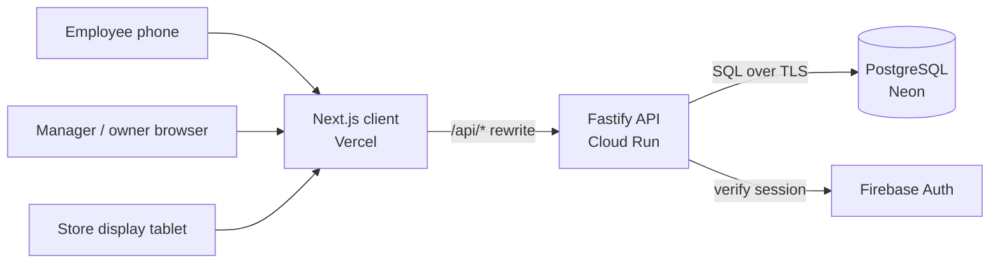
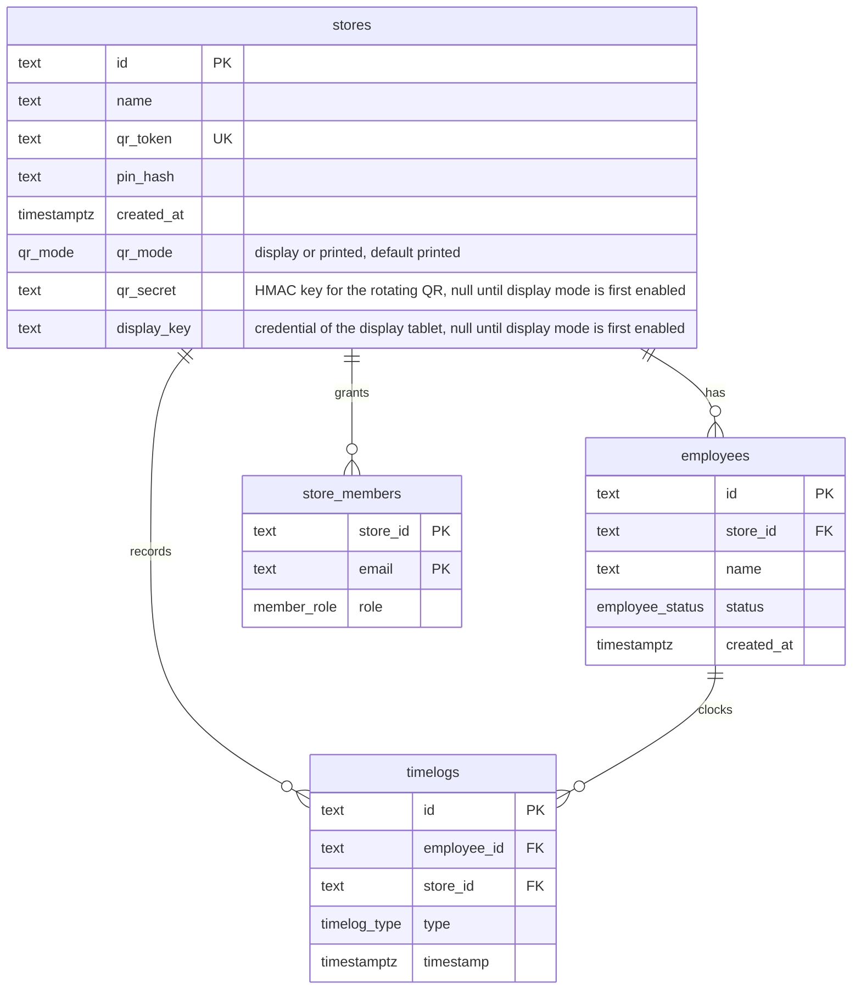

# Architecture

QRShift is moving from a single Next.js app (client + route handlers + Firestore) to a client-server split: a Next.js client, a standalone Fastify API, and PostgreSQL. This document describes both the current state and the target, and is updated as each part lands.

## Status

| Component | Current | Target |
| --- | --- | --- |
| Client | Next.js on Vercel (`web/`) | Same, with no server code |
| API | Fastify on Cloud Run (`api/`), serving all `/api/*` routes once `API_ORIGIN` is set; legacy Next.js handlers kept for rollback until phase 3 | Fastify on Cloud Run (`api/`) |
| Database | PostgreSQL on Neon once `API_ORIGIN` is set (Firestore kept read-only for rollback) | PostgreSQL on Neon |
| Auth | Store PIN + signed cookie | Firebase Authentication + roles |

## Target system

The browser only talks to the Vercel origin. Vercel forwards `/api/*` to Cloud Run, so session cookies stay first-party. Only the API can reach the database.

## Repository layout

| Path | Responsibility |
| --- | --- |
| `web/` | UI routes: `/` landing, `/scan/[qr_token]`, `/dashboard/[qr_token]`, `/reports/[qr_token]`, `/admin` |
| `api/` | Fastify REST API; `buildApp()` in `src/app.ts` is the entry used by both the server and tests |

## Data model

PostgreSQL schema, defined in `api/src/db/schema.ts` with Drizzle and migrated with drizzle-kit (`api/drizzle/`). Attendance is an append-only event log: each scan inserts one `IN` or `OUT` row; shifts and payroll totals are derived from it.

Primary keys are text so existing Firestore document IDs (and printed QR tokens) carry over unchanged. Column names are snake_case to match the domain types in the web app.

`store_members` grants a signed-in email a role on a store: `owner` or `manager`. Emails are stored trimmed and lowercase (`normalizeEmail`), the primary key is `(store_id, email)` and an index on `email` serves the "my stores" lookup. Queries live in `api/src/db/repo.ts`: `getMemberRole`, `getMemberships` (newest store first) and `assignOwnerToAllStores`. The table is added by an expand-only migration, so the running revision ignores it.

At cutover, `npm run import:firestore -w @qrshift/api` copies Firestore into these tables once, rejecting invalid documents and checking every row after the write. See [operations](operations.md#firestore-import).

## Deployment

The API ships as a Docker image (`api/Dockerfile`, Node 22, non-root user) to Cloud Run in `europe-west3`, next to Neon in Frankfurt. Cloud Run scales to zero when idle and is capped at 3 instances, which keeps it inside the free tier and under Neon's connection limit. See [operations](operations.md).

## Error codes

| Code | Status | Meaning |
| --- | --- | --- |
| `not_found` | 404 | Unknown route |
| `store_not_found` | 404 | Store missing (public, manager and owner employee routes) |
| `invalid_request` | 400 | Missing or malformed body fields (clock, report correction, owner create-store); any other framework 4xx |
| `payload_too_large` | 413 | Request body over the size limit |
| `invalid_transition` | 400 | Clock action does not follow the employee's latest log |
| `clock_failed` | 400 | Clock action could not be saved |
| `invalid_range`, `future_correction_not_supported`, `report_correction_failed` | 400 | Report correction rejected |
| `employee_not_found` | 404 | Employee missing |
| `employee_store_mismatch`, `duplicate_employee_name`, `invalid_employee_name`, `no_employee_changes`, `employee_create_failed`, `employee_update_failed` | 400 | Employee changes rejected |
| `not_display_mode` | 400 | Scan ticket requested for a store in printed mode |
| `qr_expired` | 403 | Display QR older than 60 s, tampered, for another store, or its `w`/`sig` missing or malformed |
| `invalid_pin` | 400 | Manager PIN is not numeric or longer than 6 digits |
| `unsupported_media_type` | 415 | Body is not `application/json` |
| `internal_error` | 500 | Unexpected failure; details only in the server log |
| `db_unavailable` | 503 | Health check cannot reach the database |

## QR signing

Display-mode QR codes carry no state on the server. For a store with `qr_secret`:

- `window = floor(serverNow / 30 s)`, `sig = base64url(HMAC-SHA256(qr_secret, JSON.stringify(["w", storeId, window])))`.
- `scan-ticket` accepts the current or previous window, so a QR works for at most 60 s after it first appears on the display. Older or future windows, tampered signatures and other stores' signatures are rejected.
- A ticket is `{ storeId, exp = now + 120 s, mac = HMAC(qr_secret, JSON.stringify(["t", storeId, exp])) }`. The `w`/`t` tags and JSON encoding keep tickets and window signatures from being interchangeable, whatever characters a store id contains.
- All comparisons use `timingSafeEqual`; only the server clock is used; an empty secret never verifies.
- Reissuing the QR (new `qr_secret`) invalidates every outstanding QR and ticket at once.

Code: `api/src/qr.ts`.
